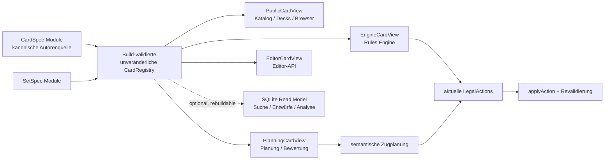

# Zentrale Kartenspezifikation und Card Registry

Status: aktueller Architekturvertrag

Die `CardSpec` ist die Autorenquelle pro Regelkarte. Ihr Abschnitt `engine`
enthält die deklarative Mechanik. Die Rules Engine validiert und vollzieht
Aktionen. Generische Engine-Primitive, Tests, Szenarien, Set-Metadaten und
Bilddateien gehören zu ihren jeweiligen Verträgen.

Die Registry erstellt pro JavaScript-Isolat unveränderliche Sichten für Engine, KI,
Katalog und Editor. Karten-Lookups verwenden die kurze numerische
`cardDefinitionId`. Spielzustände halten nur Instanz- und
Definitionsreferenzen. Statische Kartendaten werden zwischen Partien geteilt.
Die Spiel- und Planungsruntime liest die Registry im Speicher.

## Architekturprinzipien

1. **Rules Engine als einzige Regelautorität.** CardSpecs beschreiben Regeln;
   die Engine validiert und führt sie aus.
2. **LegalAction-Disziplin.** Die KI plant semantisch, reicht aber nur aktuell
   materialisierte und erneut validierte LegalActions ein.
3. **Determinismus.** Registry-Reihenfolge, Fähigkeitsschlüssel und
   Projektionen sind unabhängig von Dateisystem- oder Importreihenfolgen.
4. **Side Safety.** Öffentliche Projektionen enthalten weder interne
   KI-Metadaten noch verdeckte Instanzdaten.
5. **Keine stille Ersatzquelle.** Fehlt eine CardSpec, Fähigkeit oder Bindung,
   scheitert der betroffene Pfad strukturiert und fail-closed.
6. **Keine per-card Sonderprogrammierung.** Neue Mechanik entsteht als
   generischer deklarativer Vertrag plus generische Engine-Ausführung; die
   Karte komponiert diese Fähigkeit nur.
7. **Strikte Serialisierbarkeit.** Finale CardSpecs enthalten ausschließlich
   schemaerlaubte Plain Objects, Arrays, Strings, Zahlen, Booleans und `null`;
   Funktionen, Runtimeobjekte, Zyklen und uneindeutiges `undefined` sind
   unzulässig.
8. **Konservative Longtails.** Nicht sicher statisch auswertbare Mechanik wird
   als `requires_engine_quote` oder `unknown` ausgewiesen. Vollständige
   Longtail-Normalisierung ist keine Vorbedingung der Zentralisierung.

## Registry und Projektionen



### Kanonische CardSpec

Die verbindliche TypeScript-Oberfläche steht in [contracts.ts](../../packages/cards/src/contracts.ts). Ihre fachliche Gliederung lautet.

```ts
type CardSpec = {
  identity: CardIdentitySpec;
  text: CanonicalCardTextSpec;
  rules: CardRulesSpec;
  engine: CardMechanicalSpec;
  planningAnnotations?: CardPlanningAnnotations;
  printings: readonly PrintingSpec[];
  publication: CardPublicationSpec;
};
```

`engine` enthält die mechanische Wahrheit einschließlich Timing, Kosten,
Conditions, Limits, Targets, Effekten, Installationsbindungen,
Lifecycle-Folgen und sonstigen deklarativen Mechaniken.

`rules` enthält ausschließlich nicht ausführbare Regelstruktur und
Regelquellenbezug. Es enthält keine Engine-Eingaben oder mechanischen Felder
und darf `engine` weder spiegeln noch überschreiben. Sobald ein Wert
Legalität, Kosten, Timing, Condition, Limit, Target, Effekt oder
Zustandsänderung beeinflusst, liegt er allein in `engine`; öffentliche Regel-
und Katalogsichten leiten ihn von dort ab. Damit entsteht auch zwischen
`rules` und `engine` keine zweite mechanische Wahrheit.

`planningAnnotations` enthält ausschließlich nicht mechanisch ableitbare
Interpretation wie Taktiksignal, Strategy Support, strategische Rolle,
Target-Präferenz, Value-/Risk-Interpretation oder die bewusste Zuordnung zu
einem bestehenden Planowner. Kosten, Timing, Mengen, Limits, mechanische
Conditions und Targets, Zustandsänderungen sowie aktuelle Legalität dürfen
dort weder dupliziert noch überschrieben werden. Ein Strukturguard erzwingt
diese Grenze.

`publication` darf redaktionelle Zustände wie `active`, `experimental` oder
`disabled` führen. Tatsächlicher Engine-/KI-Support und Testcoverage werden
aus Registry, Verträgen und Tests abgeleitet und nicht als zweite manuelle
Statuswahrheit gespeichert.

Die Teiltypen verhindern einen unstrukturierten „God Object“-Typ und werden
einzeln validiert.

### Serialisierbarkeitsvertrag

Eine finale CardSpec besteht ausschließlich aus Plain Objects, Arrays,
Strings, endlichen Zahlen, Booleans und `null`, soweit das Schema `null`
ausdrücklich vorsieht. Funktionen, Closures, Klasseninstanzen, `Map`, `Set`,
`Date`, RegExp, Symbole, zyklische Referenzen, umgebungsabhängige Werte und
uneindeutige `undefined`-Eigenschaften sind ausgeschlossen. Pure Helper sind
nur zulässig, wenn ihr Ergebnis den Vertrag erfüllt. JSON-Roundtrip,
kanonische Serialisierung und Deep-Freeze werden durch Tests belegt.

### Regelidentität, Druck und Set

Die Architektur unterscheidet drei Dinge:

- `CardSpec`: eine Regelidentität mit stabiler `cardDefinitionId`;
- `PrintingSpec`: ein konkreter Druck mit `printingId`, `setId`,
  Sammlungsnummer, Seltenheit, Bildvarianten und optionalen
  druckspezifischen Textabweichungen;
- `SetSpec`: Metadaten des Sets selbst, etwa Name, Code, Reihenfolge und
  Freigabestatus.

Die Set-Zugehörigkeit einer Karte liegt damit in ihren `printings`. Das Set
bleibt eine eigene Entität, weil sein Name, seine Veröffentlichung oder seine
Sortierreihenfolge nicht pro Karte dupliziert werden sollen. Dieselbe
Regelkarte kann mehrere Printings in unterschiedlichen Sets besitzen, ohne
ihre Engine- oder Planungsbeschreibung zu kopieren.

`text.rulesText` ist der für die Regelidentität maßgebliche aktuelle
Text. Soll ein historischer oder alternativer Druck sichtbar abweichenden
Face-Text tragen, kann ausschließlich dessen Printing einen
`faceTextOverride` führen. Dieser Override verändert nicht automatisch die
ausführbare Regel; eine echte Regeländerung benötigt eine neue
`cardRulesFingerprint`-Version oder, wenn sie nicht mehr dieselbe Regelidentität
darstellt, eine neue `cardDefinitionId`.

### Bilder

Bilddateien bleiben Assets außerhalb der CardSpec. Der Standardpfad wird aus
der stabilen `printingId` abgeleitet, nicht aus dem veränderlichen Kartentitel.
Damit sind Sonderzeichen, Umbenennungen und gleiche Titel unkritisch.

Ein Printing kann optional benannte Varianten deklarieren, zum Beispiel
`default`, `alternate-art` oder `promo`. Solange NETGRID nur eine Variante
braucht, genügt die abgeleitete Standardkonvention; es entsteht kein
Pflichtfeld pro Karte.

### Generische Engine-Primitive bleiben eigenständig

„Eine Datei pro Karte“ bedeutet nicht, dass dieselbe Mechanik in jeder Karte
neu programmiert wird. Die heutigen generischen Helfer und deklarativen
Capability-Verträge bleiben die Grundlage. Broker würde beispielsweise in
seiner CardSpec generische Hosted-Credit-Fähigkeiten mit Betrag, Timing, Limit
und stabilem `capabilityKey` komponieren.

Die konkrete Zustandsänderung bleibt im generischen Engine-Primitive. Ist
eine neue Karte mit den vorhandenen Primitiven nicht ausdrückbar, wird zuerst
der generische Vertrag und seine Engine-Ausführung erweitert. Ein versteckter
per-card Switch oder ein KI-Sonderfall ist kein zulässiger Ersatz.

### Deterministische Registry-Erzeugung

TypeScript entdeckt neue Dateien nicht automatisch. Laufzeit-Scanning des
Dateisystems wäre für Bundling, Engine-Reinheit und Determinismus ungeeignet.

Verbindlich ist deshalb ein buildseitig erzeugter Importindex:

1. Ein Generator findet CardSpec-Module anhand einer festen Pfadkonvention.
2. Er sortiert sie nach `cardDefinitionId`.
3. Er erzeugt ausschließlich Imports und eine deterministische Liste.
4. Validierung beweist Eindeutigkeit, Schema und referenzielle Integrität.
5. CI schlägt fehl, wenn der Index nicht zum Quellenbestand passt.

Der generierte Index enthält keine fachlichen Kartendaten und ist deshalb
keine zweite Autorenquelle. Eine manuelle produktive Importliste ist
ausgeschlossen.

### Typisierte Projektionen statt Datenkopien

Die Registry hält pro Regelidentität genau ein unveränderliches Objekt. Daraus
werden schmale Sichten abgeleitet:

| Sicht              | Erlaubter Inhalt                                       | Ausgeschlossen                                |
| ------------------ | ------------------------------------------------------ | --------------------------------------------- |
| `PublicCardView`   | öffentliche Druck- und Regeltexte, Set-/Bildreferenzen | PlanningAnnotations, interne Handlerdaten     |
| `EngineCardView`   | Regelwerte, deklarative Abilities, Capability Keys     | Editorentwürfe, Suchindizes                   |
| `PlanningCardView` | side-sichere Regeln und PlanningAnnotations            | verdeckte Instanzdaten, zukünftige Action-IDs |
| `EditorCardView`   | editierbare CardSpec-Felder, Validierungsstatus        | Runtime-Matchzustand                          |

Die Projektionen sind pure Funktionen mit Compile-time-Typgrenzen und werden
nicht als zusätzliche JSON-Dateien dauerhaft gespeichert. Engine importiert
ausschließlich `/engine`; AI importiert `/planning` sowie ausdrücklich
erlaubte Public-/Engine-Deskriptoren. Der normale Browser importiert nur
`/public` oder erhält öffentliche API-DTOs. Exportmaps allein reichen nicht:
Package- und Source-Structure-Gates prüfen die Importgrenzen.

Die KI liest mechanische Eigenschaften und Annotationen aus
`PlanningCardView`. Für statische Fakten zu einer bekannten Karte verwendet sie die
schreibgeschützte Sicht `CardPlanningFacts`. Beide Sichten stammen aus derselben
Registry. Der Engine-Zugang kompiliert die für Regelanwendung und
Anzeigeprojektion benötigten Laufzeitdefinitionen. Drucktexte für den Katalog
und Kartenfreigaben werden aus der öffentlichen Sicht beziehungsweise dem
aktuellen Laufzeit-Kartenpool abgeleitet.

### Abschnittsbezogene Fingerprints

Ein einzelner Hash über die vollständige CardSpec würde harmlose Bild-, Text-
oder Planungsänderungen mit Regeländerungen vermischen. Die Registry leitet
daher getrennt ab:

- `cardRulesFingerprint` für Regelwerte und mechanische CardSpec-Semantik;
- `textFingerprint` für kanonischen und druckspezifischen Text;
- `printingFingerprint` für Druck- und Bildzuordnung;
- `planningAnnotationsFingerprint` für nicht mechanische
  Planungsinterpretation;
- `publicationFingerprint` für den redaktionellen Publication-Zustand.

Der `cardRulesFingerprint` ist ausdrücklich nicht der vollständige Rules- oder
Replaykontext. Replay und Planung verwenden zusätzlich den übergreifenden
Engine-Kontext: Engine-Schema, Card-Implementation-/Primitive-Version,
Card-Pool sowie relevante Action-Semantic-/Planner-Versionen. Dadurch bleibt
eine reine Text- oder Bildkorrektur ohne Mechanikänderung replayneutral,
während eine geänderte generische Primitive-Ausführung auch bei unveränderter
CardSpec im Rules-Kontext sichtbar wird. Die Speicherung darf den StateHash
nicht von reinen Katalogänderungen abhängig machen.

## Capability-Identität und prospektive Fähigkeiten

Die CardSpec beseitigt die Informationslücke, ersetzt aber keine
Zugsimulation und keine aktuelle Engine-Autorisierung.

### Stabile Capability-Identität

Jeder planungs- oder Action-adressierbare mechanische Knoten erhält einen
innerhalb der CardSpec stabilen `capabilityKey`. Für normale aktivierte
Fähigkeiten darf `abilityKey` als typisierter Alias dienen. Die kanonische
Identität ist eine positive numerische `CanonicalCapabilityId`. Der
[generierte Fähigkeitsindex](../../packages/cards/src/generated/card-capability-ids.ts)
ordnet sie derselben Kartendefinition und demselben lokalen Schlüssel zu.
Neue Fähigkeiten werden mit `pnpm generate:card-capability-ids` angehängt.
Der Generator lässt Nummern entfernter Fähigkeiten reserviert.

Sie darf in einer `CanonicalLegalActionInvocation` als `sourceAbilityId`
transportiert werden, ersetzt aber weder das `capabilityId` einer
Plan-Step-Anforderung noch die `actionId` einer aktuellen LegalAction oder die
`sourceCardInstanceId` einer konkreten Karteninstanz. Passive Knoten benötigen
nur dann einen Key, wenn Planung, Action-, Choice- oder Quote-Bindung oder eine
strukturierte Diagnose sie individuell adressieren muss.

### Statische Prospective Capability View

`compileProspectiveCapabilities(CardSpec)` erzeugt eine
`ProspectiveCapabilityView` und leitet ohne GameState, PlayerView, LegalAction
oder AI-Plan mindestens ab:

- den Quellenzustand, in dem eine Capability existiert;
- den deklarativen Übergang dorthin, etwa `install`, `play`, `rez` oder
  `score`;
- direkte deterministische Übergangsfolgen;
- initialisierte Kartenwerte und gebundene Installationschoices;
- entstehende Verpflichtungen und Lifecycle-Liabilities;
- Kosten-, Timing-, Condition-, Limit-, Target- und Effect-Deskriptoren;
- die stabile Capability-Identität;
- die statische Unsicherheitsklasse.

Diese Sicht wird ausschließlich aus `engine`, den generischen
Primitivverträgen und nicht mechanischen `planningAnnotations` abgeleitet. Sie
ist keine separat gepflegte Quelle.

### Zustandsbezogene side-sichere Projektion

Eine side-sichere Projektion kann die statische Sicht gegen einen sichtbaren,
geplanten Zielzustand konservativ klassifizieren:

- `available_by_spec`: Die Capability existiert nach dem deklarierten
  Übergang;
- `feasible_in_projection`: Sichtbare Kosten, Timing und bekannte Bedingungen
  erscheinen im geplanten Zug erreichbar;
- `blocked`: Eine bekannte Bedingung ist nicht erfüllt;
- `requires_engine_quote`: Nur eine exakt definierte Engine-Quote kann die
  dynamische Frage beantworten;
- `unknown`: Die statische Evidenz reicht für keine sichere Aussage.

`feasible_in_projection` ist keine Legalitätsgarantie. Aktuelle Legalität kann
nur eine aktuelle LegalAction oder eine exakt definierte Engine-Quote
beweisen. Nach einer echten Zustandsänderung bindet die AI anhand von
`sourceCardInstanceId`, kanonischer Capability-Identität und aktueller
`stateVersion` auf die exakte aktuelle LegalAction neu. Eine fehlende oder
mehrdeutige Bindung scheitert fail-closed; eine ähnliche Ersatzaktion ist
unzulässig.

### Wann weiterhin Simulation oder Engine-Quote nötig ist

Statische CardSpec-Auswertung genügt nicht für:

- Zufallsergebnisse;
- verdeckte gegnerische Information;
- mehrstufige Choices;
- Reaktionsfenster des Gegners;
- variable Ziele oder Kosten, die erst die Engine exakt bestimmt;
- Wechselwirkungen mehrerer permanenter Effekte.

Für solche Fälle bleibt eine begrenzte, generische Engine-Quote oder spätere
Zugsimulation sinnvoll. Longtails werden bis dahin korrekt als
`requires_engine_quote` oder `unknown` klassifiziert. Sie blockieren die
Zentralisierung nicht und werden nicht durch einen Legacy-Fallback oder eine
zweite Mechanikquelle kaschiert.

## Redaktioneller Bestand und Laufzeitverfügbarkeit sind getrennt

Die Registry enthält neben den spielbaren Sets auch interne Testkarten und
technische Systemidentitäten. Daraus folgt nicht, dass jeder Registry-Eintrag
im normalen Produktkartenpool angeboten werden darf.

Der normale serverseitige Laufzeit-Snapshot schließt das Set
`testset` aus. Deckvalidierung, Matchaufbau und Projektionen für Katalog,
Vorlagen und Snapshots verwenden dieselbe Ausschlussgrenze. Eine lokale
Diagnosesitzung darf Testkarten ausschließlich durch die ausdrückliche
Backend-Konfiguration `NETGRID_ENABLE_TEST_CARDS=true` aktivieren; Default und
ungültige Konfiguration sind fail-closed. Das aktive Set `system` enthält nur
technisch erforderliche Identitäten und bleibt davon unabhängig. UI-Filter
bilden den serverseitig verfügbaren Bestand ab und sind keine eigene
Freigabeautorität.

## Optionale SQLite-Projektion

### Entscheidung

Die Anwendung lädt veröffentlichte CardSpec-Module in die In-Memory-Registry.

Eine spätere SQLite-Projektion ist sinnvoll, wenn mindestens eine konkrete
Anforderung vorliegt:

- Volltextsuche über Regeln, Flavor und KI-Klassifikation;
- komplexe Filter und Aggregationen im Karteneditor;
- viele getrennte Werkzeuge oder Prozesse benötigen dieselbe Abfragesicht;
- unveröffentlichte Editorentwürfe brauchen Historie und Arbeitsstände;
- Messungen zeigen einen tatsächlichen Engpass bei Registry-Projektionen.

„Der Editor benötigt weniger Felder“ ist für sich allein kein
Datenbankargument. Dafür genügt `EditorCardView`.

### Zulässiger Datenfluss

```text
versionierte CardSpecs
→ validierte CardRegistry
→ optionale, atomar neu gebaute SQLite-Projektion
→ Editor-/Such-API
```

Die Projektion soll:

- eine eigene Datei außerhalb der Match-/Account-Datenbank verwenden;
- vollständig lösch- und rekonstruierbar sein;
- den Registry- und Schema-Fingerprint speichern;
- bei Abweichung atomar neu gebaut werden;
- bei einem fehlgeschlagenen Neuaufbau sichtbar scheitern;
- niemals still mit einem veralteten Bestand weiterarbeiten;
- nicht Teil normaler Matchdaten-Backups sein.

Ein möglicher lokaler Pfad wäre
`data/runtime/card-registry/card-index.sqlite`; Laufzeitdaten werden nicht
versioniert.

### Editorentwürfe

Soll ein künftiger Editor Karten verändern, sind zwei Zustände sauber zu
trennen:

1. **Entwurf:** mutable, optional in SQLite, nicht spielbar;
2. **veröffentlicht:** validierte und versionierte CardSpec, alleinige Quelle
   für Registry und Spiel.

„Veröffentlichen“ erzeugt oder aktualisiert die CardSpec, formatiert sie und
führt die Card-, Engine- und KI-Gates aus. Ein Match darf nie direkt auf einen
DB-Entwurf zugreifen. Damit bleibt die Datenbank ein Arbeitsbereich und wird
nicht zur zweiten produktiven Autorität.

## Verifikation

| Risiko                             | Mindestnachweis                                                            |
| ---------------------------------- | -------------------------------------------------------------------------- |
| doppelte oder fehlende Karten      | Registry-Schema-, Uniqueness- und Vollständigkeitstest                     |
| instabile Capability-Bindung       | Capability-Key-Stabilitäts- und Rebinding-Test                             |
| Regelabweichung                    | LegalAction-, Effect- und fokussierte Per-card-Parität                     |
| Replay-/StateHash-Drift            | deterministischer Replay-Wiederholungstest mit vollständigem Rules-Kontext |
| Hidden-Info-Leak                   | PublicCardView-Typtest plus Golden-Payload-Test                            |
| KI übernimmt Regelautorität        | Ownership-, Action-ID-, Executor- und PlanOrigin-Test                      |
| Browser importiert Vollsicht       | Package-/Source-Structure-Guard und Bundleprüfung                          |
| Generator ist nicht reproduzierbar | zweimalige Generierung mit bytegleichem Ergebnis                           |
| mehrere Autorenquellen             | Quellscan und One-Authority-per-card/-set-Gate                             |
| veraltete SQLite-Sicht             | Fingerprint-Mismatch-Test, atomarer Rebuild, fail-closed Fehlerpfad        |
